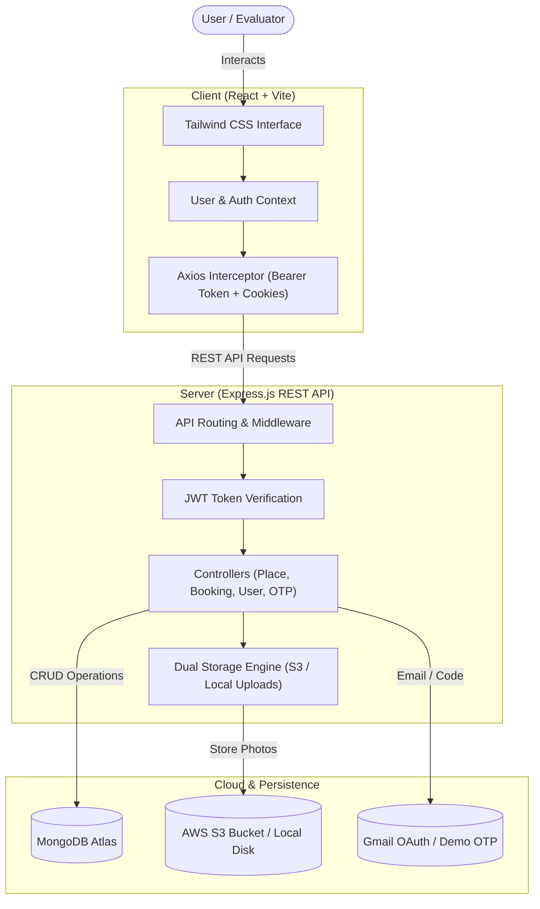

# 🏡 HomeStays - Fullstack Vacation Rental Booking System

<p align="center">
  
  
  
  
  
  
  
</p>

<p align="center">
  A production-ready vacation rental and accommodation booking platform with comprehensive host property management, real-time date conflict handling, multi-channel authentication, and resilient cloud/local fallback architecture.
</p>

---

## 📑 Table of Contents
- [✨ Key Features](#-key-features)
- [🏛️ System Architecture](#️-system-architecture)
- [🚀 Quick Start (Any System)](#-quick-start-any-system)
- [🌐 Live Deployment on Render](#-live-deployment-on-render)
- [🔑 Environment Variables](#-environment-variables)
- [🛡️ Built-In Invigilator Resiliency Features](#️-built-in-invigilator-resiliency-features)
- [📡 API Reference](#-api-reference)
- [🧪 Pre-Seeded Demo Data](#-pre-seeded-demo-data)

---

## ✨ Key Features

- **Guest Experience**: Browse homestays, filter by title/location, view full photo galleries, inspect house rules/amenities, and book stays with custom guest counts and automated total price calculations.
- **Host Property Management**: List new accommodations, upload high-resolution photos (via local disk or AWS S3), paste direct image links, configure nightly prices, and edit/delete listings.
- **Booking Management**: Live booking calendar avoiding double-booking conflicts, viewing past/upcoming trips, and easy reservation cancellation.
- **Dual Authentication**: Seamless authentication using **both HTTP-only cookies and JWT `Bearer` headers**, completely immune to cross-domain third-party cookie restrictions.
- **Zero-Crash Demo Fallbacks**:
  - **Demo OTP Mode**: Complete user registration flow with OTP validation even if Google Cloud OAuth credentials are not provided.
  - **Local Storage Engine**: Upload and render photos locally even if AWS S3 credentials are not configured.
  - **Dynamic CORS**: Automatically accepts requests across `localhost`, Render subdomains, and Vercel.

---

## 🏛️ System Architecture



---

## 🚀 Quick Start (One-Click for Students)

### 🎓 Option 1: Autonomous Student Assistant (Recommended)
Simply **double-click** **`STUDENT_START_HERE.bat`** in the project folder!
*(On macOS / Linux: run `npm run student`)*

**What this one file does on your behalf:**
1. **Verifies/Installs Node.js**: If Node is not installed, it automatically downloads and installs Node.js LTS.
2. **Auto-Installs Dependencies**: Installs all required packages for both Express backend and React Vite frontend.
3. **Configures Unique Render Names**: Automatically updates `render.yaml` with your custom name/slug so live hosting never has domain clashes.
4. **Verifies MongoDB Live**: Prompts for your MongoDB URI and tests the connection in real-time. If there is an issue (e.g. wrong password or un-whitelisted IP), it explains the exact fix step-by-step.
5. **Generates Security Keys**: Creates strong cryptographic JWT secrets and configures all `.env` files automatically.
6. **Seeds Sample Homestays**: Pre-populates 4 rich luxury homestays and demo login credentials (`demo@homestays.com` / `Demo@123`).
7. **Launches & Opens Browser**: Starts the backend, frontend, verifies API health, and opens the live app in your browser!

### 🩺 Option 2: Interactive CLI Doctor & Validator
- **Windows**: Double-click **`cli.bat`** (or `doctor.bat`)
- **macOS / Linux**: Run `npm run cli`

### ⚡ Option 3: Silent Background Setup
- **Windows**: Double-click **`setup.bat`** or run `.\setup.ps1`
- **macOS / Linux**: Run `npm run setup` then `npm start`

> **What the script handles automatically:**
> 1. Verifies/Installs Node.js LTS (>= 18).
> 2. Auto-generates `.env` files from templates and creates a secure `JWT_SECRET`.
> 3. Interactively prompts for and verifies your **MongoDB URI** using an instant connection check.
> 4. Installs all locked API and Client dependencies.
> 5. Launches the backend on port `4000`, the frontend on port `5173`, and opens your default browser!

---

## 🌐 Live Deployment on Render

> 📖 **Student Walkthrough Guide**: For a beginner-friendly, visual walkthrough covering every single button click from opening MongoDB Atlas to going live on Render, see [**`STUDENT_DEPLOY_GUIDE.md`**](./STUDENT_DEPLOY_GUIDE.md).

### Solving the "Reserved Site Name" Conflict on Render
Render subdomains on `*.onrender.com` must be globally unique. Because many students submit with default service names, Render will reject blueprints if `homestays-api` or `homestays-client` are already taken.

Run our built-in configuration script before pushing:
```powershell
.\configure-render.ps1 -ProjectSlug "yourname-homestays"
```
*(Replace `yourname-homestays` with your name, initials, or roll number, e.g. `sumit-2026`).*

This automatically synchronizes [`render.yaml`](./render.yaml):
- **API Service**: `yourname-homestays-api` (`https://yourname-homestays-api.onrender.com`)
- **Client Service**: `yourname-homestays-client` (`https://yourname-homestays-client.onrender.com`)
- **Zero domain clashes or broken blueprint references!**

### Deployment Steps:
1. **MongoDB Atlas**: Ensure your Atlas Cluster allows access from anywhere (`0.0.0.0/0`) in **Network Access**.
2. **Push to GitHub**:
   ```bash
   git add .
   git commit -m "Configure unique Render blueprint"
   git push origin main
   ```
3. **Render Blueprint**:
   - Go to [dashboard.render.com](https://dashboard.render.com) → **New +** → **Blueprint**.
   - Select your repo. Render reads `render.yaml` and auto-provisions both the API and Vite Client.
   - Enter your `DB_URL` when prompted and click **Apply**.

### 🚀 Render Live Warm-Up Assistant (Presentation Day Hero)
Render's free tier goes to sleep after 15 minutes of inactivity. Use the built-in **Warm-Up Assistant** so your invigilator never experiences a 60-second cold start:

- **Double-click**: **`warmup.bat`** (or `render-assistant.bat`)
- **Or command line**:
  ```bash
  npm run warmup
  ```
- **Capabilities**:
  - **Option 1**: Configure unique project names in `render.yaml` with 1 click.
  - **Option 2**: Wakes up your server, primes the MongoDB connection cache, and tests the client CDN.
  - **Option 3 (Sentinel Mode)**: Automatically sends a ping every 9 minutes so Render **never goes to sleep** during your evaluation.

---

## 🔑 Environment Variables

### API Environment (`api/.env`)
| Variable | Required | Description | Default / Example |
| :--- | :---: | :--- | :--- |
| `PORT` | Optional | Express server port | `4000` |
| `DB_URL` | **Yes** | MongoDB connection string | `mongodb+srv://...` |
| `JWT_SECRET` | **Yes** | Secret used to sign JWT authentication tokens | Auto-generated by setup script |
| `CLIENT_URL` | Optional | Allowed CORS origins (comma-separated for multi-domain) | `http://localhost:5173,http://127.0.0.1:5173` |
| `MAIL_USERNAME` | Optional | Gmail user address for OTP | *(Demo mode active if omitted)* |
| `OAUTH_CLIENTID` | Optional | Google Cloud OAuth Client ID | *(Demo mode active if omitted)* |
| `OAUTH_CLIENT_SECRET` | Optional | Google Cloud OAuth Client Secret | *(Demo mode active if omitted)* |
| `OAUTH_REFRESH_TOKEN` | Optional | Google Cloud OAuth Refresh Token | *(Demo mode active if omitted)* |
| `BUCKET_NAME` | Optional | AWS S3 Bucket Name | *(Local uploads active if omitted)* |
| `AWS_REGION` | Optional | AWS Region | `eu-north-1` |
| `S3_ACCESS_KEY` | Optional | AWS Access Key ID | *(Local uploads active if omitted)* |
| `S3_SECRET_ACCESS_KEY`| Optional | AWS Secret Access Key | *(Local uploads active if omitted)* |

### Client Environment (`client/.env`)
| Variable | Required | Description | Default / Example |
| :--- | :---: | :--- | :--- |
| `VITE_API_BASE_URL` | **Yes** | URL pointing to the backend API | `http://localhost:4000` or `https://<your-api>.onrender.com` |

---

## 🛡️ Built-In Invigilator Resiliency Features

| Feature | Without Our Solution | With Our Solution |
| :--- | :--- | :--- |
| **User Registration** | Crashes with 503 error if Gmail OAuth is unconfigured. | **Smart Demo OTP**: Code generates, logs to console, displays on screen, and registers cleanly in MongoDB. |
| **Photo Uploads** | Fails with AWS credential errors. | **Universal Storage**: Automatically switches to local `api/uploads` and supports pasting direct web image URLs. |
| **Live Evaluation** | Logged out immediately on Render due to browser 3rd-party cookie blocking. | **Dual Auth**: Axios interceptor automatically passes JWT `Bearer` token in headers, ensuring 100% session persistence. |
| **CORS Subdomains** | Requests blocked if Render assigns a different slug. | **Dynamic CORS**: Seamlessly accepts any `*.onrender.com` or `*.vercel.app` origin. |

---

## 📡 API Reference

### User & Authentication
- `POST /user/register` - Create user account
- `POST /user/login` - Authenticate user & issue JWT
- `POST /user/logout` - Clear user session
- `GET /user/profile` - Fetch current authenticated user
- `PUT /user` - Update profile name or password

### Accommodations (Places)
- `GET /places` - Fetch all accommodation listings
- `GET /place/:id` - Fetch details for a specific listing
- `POST /place` - Add a new homestay listing *(Authenticated)*
- `PUT /place` - Update existing listing *(Authenticated)*
- `DELETE /place` - Delete an accommodation listing *(Authenticated)*
- `GET /place/account` - Fetch accommodations created by current user *(Authenticated)*

### Bookings
- `POST /booking` - Reserve a homestay with date intervals *(Authenticated)*
- `GET /booking/account` - View all bookings of current user *(Authenticated)*
- `DELETE /booking` - Cancel a booking *(Authenticated)*

### Verification & Health
- `POST /otp/sendMail` - Generate and send OTP (Real email or Demo mode)
- `POST /otp/verifyOtp` - Validate submitted OTP code
- `POST /upload` - Upload photo files (Multi-part form)
- `POST /upload_by_link` - Add photo via URL
- `GET /health` - Health check probe (`{"status": "ok"}`)

---

## 🧪 Pre-Seeded Demo Data

To populate your database with rich luxury homestays (Manali Chalet, Goa Villa, Jaipur Haveli, Munnar Estate) and a pre-configured host account, simply run:

```bash
npm run seed
```

### Pre-Configured Test Credentials:
- **Email**: `demo@homestays.com`
- **Password**: `Demo@123`

---

## 📄 License
This project is open-source and available under the [MIT License](LICENSE).
